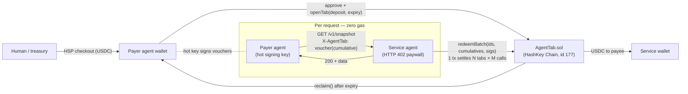
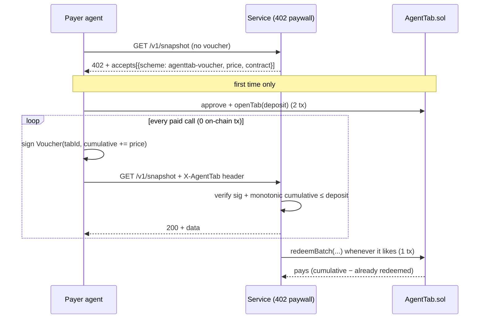

# AgentTab

**Pay-per-request agent-to-agent (A2A) settlement on HashKey Chain.** One tab, thousands of paid calls, one settlement transaction.

> Built for the **HashKey Chain Horizon Hackathon (Mumbai Edition)** — track **Agent Payments & A2A Settlement**.

---

## The problem

AI agents increasingly pay *other* agents for every API call: a trading agent polls a data agent, a planner agent calls a dozen tool agents. These calls are tiny ($0.001–$0.05) and constant. Two naive options both fail:

- **One on-chain transfer per call** — far too slow and the gas dwarfs the payment.
- **A card / merchant checkout per call** — even worse latency, and no agent can hold a card.

## The idea

`AgentTab` opens **one tab**: an on-chain escrow in USDC/USDT on HashKey Chain between a *paying* agent and a *service* agent. After that single setup, **every call is paid with an off-chain EIP-712 voucher** carrying the **cumulative** amount owed. The service verifies the voucher in microseconds with zero gas, serves the request, and later redeems the latest voucher — settling any number of calls, from any number of clients, in **one `redeemBatch` transaction**.

Signing a voucher is free and instant, so agents can pay per HTTP request (HTTP 402) at full speed. Humans fund agents through **HSP** (HashKey Settlement Platform) checkout, so HSP is the human → agent on-ramp and AgentTab is the agent ↔ agent rail.

## Architecture



### How one call flows



## Quickstart

```bash
npm install
(cd contracts && forge test)     # 10 Solidity tests
node --test test/                # 5 HSP-adapter tests
node demo/local-e2e.mjs          # full end-to-end on a local chain
```

The demo spins up a throwaway local chain, deploys `AgentTab` + a mock USDC, starts the paid service (which serves **real HashKey mainnet** block/gas data), then:

```
unpaid call -> 402 payment_required
25 paid calls OK; last response: {"chainId":177,"block":"29309228",... ,"gasPriceGwei":"500.001"}
replayed old voucher -> 402 voucher_increment_below_price
settled 1 tab(s) in 1 tx 0x3d5b…619b (success); service earned 0.25 mUSD for 25 calls; on-chain txs by agent: 2 (approve+openTab)
tab #1 remaining 0.75 mUSD
```

→ 25 paid calls cost the paying agent **2 on-chain transactions total** (approve + openTab), and the service settles all 25 in **1 transaction**.

## Deploy to HashKey Chain

One command — see **[DEPLOY.md](./DEPLOY.md)** for the exact steps, RPC, chain ID and gas estimate (deploying costs roughly **0.63 HSK ≈ $0.06**).

## What's in the repo

| Path | What it is |
|---|---|
| `contracts/src/AgentTab.sol` | Escrow + EIP-712 cumulative-voucher redemption, batch settlement, top-up, expiry reclaim |
| `contracts/test/AgentTab.t.sol` | 10 Foundry tests incl. a fuzz invariant: the payee can never receive more than the deposit |
| `contracts/script/Deploy.s.sol` | One-command deploy script |
| `gateway/paywall.mjs` | HTTP 402 middleware: verifies vouchers off-chain, rejects replay & concurrent double-spend, batch-settles |
| `gateway/server.mjs` | Example paid service: a live HashKey Chain snapshot feed for trading agents, plus `/hsp/topup` & `/hsp/webhook` |
| `agent/client.mjs` | `TabAgent.fetch()` — a drop-in `fetch` that transparently pays 402s |
| `hsp/hsp.mjs` | HSP merchant adapter (Cart Mandate, HMAC-SHA256 signing, ES256K `merchant_authorization` JWT, webhook verify) |
| `demo/local-e2e.mjs` | The end-to-end demo above |

## Why it's safe

- **A voucher can never pay more than the deposit** (enforced on-chain; proven by a fuzz test).
- **Vouchers are bound to `chainId`, the contract and the `tabId`** via the EIP-712 domain, so they can't be replayed across tabs or chains.
- **Stale vouchers are a no-op**, which keeps batch settlement robust.
- **Only low-s signatures** are accepted (no malleability); calls are **reentrancy-guarded**.
- **Expiry safety:** after `expiry` the payer reclaims whatever the service didn't redeem; the paywall stops accepting vouchers 120 s before expiry.
- **Key separation:** vouchers are signed by an **agent hot key that holds no funds**. The deposit comes from a separate payer wallet (a human/treasury wallet funded via HSP). A compromised agent can lose at most the open tab balance, and the agent client also enforces a per-service spend cap.

## HSP integration

`hsp/hsp.mjs` builds HSP **Cart Mandates** so a human can top up an agent's wallet/tab in USDC on HashKey Chain through HSP checkout. It implements the documented HSP auth scheme: HMAC-SHA256 request signing (`X-App-Key/-Signature/-Timestamp/-Nonce`), an **ES256K** `merchant_authorization` JWT with a `cart_hash` over RFC-8785 canonical JSON, and HMAC webhook verification. The gateway exposes `/hsp/topup` and `/hsp/webhook`.

## Honest limitations

- The HSP adapter follows the **publicly summarised** HashKey merchant docs. Until HSP app keys are issued it runs in **dry-run** mode (it builds and signs the request but doesn't send it), and the exact endpoint/header names should be confirmed against the official HashKey merchant PDF on hashfans.io before mainnet use.
- Gateway voucher state is **in memory**. Production must persist the latest voucher per tab and must settle before `expiry`.
- The contract is **unaudited**. It's deliberately small (~150 lines) and fully tested, but it has not had a third-party review.
- The paid demo service reads live HashKey mainnet data; if that RPC is unreachable it returns a structured `data_source_unavailable` error rather than failing the payment check.

## License

MIT
